# บทที่ 2 (ตอนที่ 4) — เนื้อหาฉบับร่างสำหรับหัวข้อ 2.22–2.24 และ 2.26

รูปทั้งหมดอยู่ที่ `img/` จับจากเว็บจริง (`01418321-final-project/`, production build, จอ 1440 px) ด้วยข้อมูลตัวอย่างตั้งต้น
เลขรูปยังไม่ได้ใส่ ให้ใส่ตอนรวมเล่ม

ยังไม่มีในไฟล์นี้: 2.25 SQL Statement (รอ ER Diagram) และ 2.27 หน้าที่รับผิดชอบ

---

## 2.22 Software Development Platform

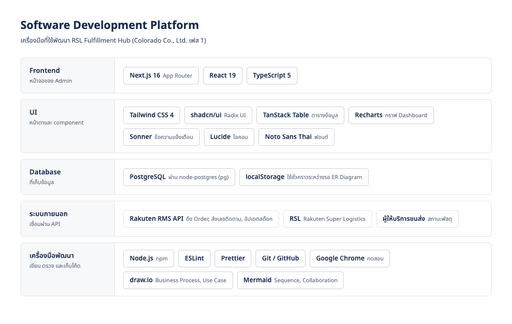

รูปแสดงเครื่องมือที่ใช้พัฒนาระบบ

| ส่วน | เครื่องมือ | ใช้ทำอะไร |
|---|---|---|
| Frontend | Next.js 16 (App Router), React 19, TypeScript 5 | สร้างหน้าจอทั้งหมดของ Admin |
| UI | Tailwind CSS 4, shadcn/ui (Radix UI), TanStack Table, Recharts, Sonner, Lucide, ฟอนต์ Noto Sans Thai | หน้าตา ตาราง กราฟ ข้อความแจ้งเตือน และไอคอน |
| Database | PostgreSQL ผ่าน node-postgres (`pg`) | เก็บข้อมูลจริง ตอนนี้ใช้ localStorage แทนไปก่อนระหว่างรอ ER Diagram แก้ที่ `src/lib/store.tsx` จุดเดียว |
| ระบบภายนอก | Rakuten RMS API, RSL, ผู้ให้บริการขนส่ง | ดึง Order, ส่งเลขติดตาม, อัปเดตสต๊อก, จับคู่เลข RSL, ดึงสถานะพัสดุ |
| เครื่องมือพัฒนา | Node.js (npm), ESLint, Prettier, Git/GitHub, Google Chrome, draw.io, Mermaid | เขียนและตรวจโค้ด เก็บโค้ด ทดสอบ และวาด diagram |

---

## 2.23 Site Map / UI Structure

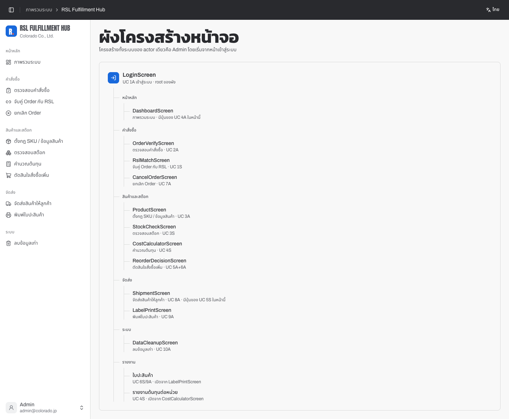

รูปแสดงโครงสร้างหน้าจอของระบบ

ระบบมีผู้ใช้คนเดียวคือ Admin (เจ้าของร้าน) จึงมี tree เดียว root คือ LoginScreen
หลังเข้าสู่ระบบจะเห็นเมนูด้านซ้ายแบ่งเป็น 5 กลุ่ม

```
LoginScreen (1A)
└── DashboardScreen (ปุ่มนำเข้า Order ของ 4A)
    ├── คำสั่งซื้อ
    │   ├── OrderVerifyScreen (2A)
    │   ├── RslMatchScreen (1S)
    │   └── CancelOrderScreen (7A)
    ├── สินค้าและสต๊อก
    │   ├── ProductScreen (3A)
    │   ├── StockCheckScreen (3S)
    │   ├── CostCalculatorScreen (4S) ── รายงานต้นทุนต่อหน่วย
    │   └── ReorderDecisionScreen (5A + 6A)
    ├── จัดส่ง
    │   ├── ShipmentScreen (8A, ปุ่มส่งเลขติดตามของ 5S)
    │   └── LabelPrintScreen (9A) ── ใบปะสินค้า
    └── ระบบ
        └── DataCleanupScreen (10A)
```

UC ที่ระบบทำเอง (2S, 6S, 7S) ไม่มีหน้าจอของตัวเอง ผลจะขึ้นเป็นข้อความแจ้งเตือนในหน้าที่ Admin เปิดอยู่

### User Interface Design

ชื่อหน้าจอตรงกับชื่อ Screen object ใน Sequence Diagram

| หน้าจอ | UC | รูป |
|---|---|---|
| LoginScreen | 1A เข้าสู่ระบบ | 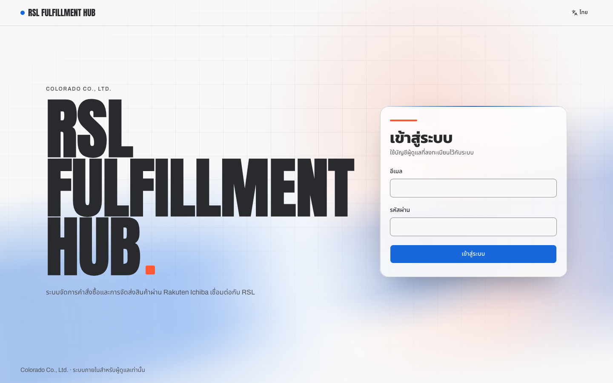 |
| DashboardScreen | 4A ดึง Order เข้าระบบ (ปุ่มนำเข้า Order) | 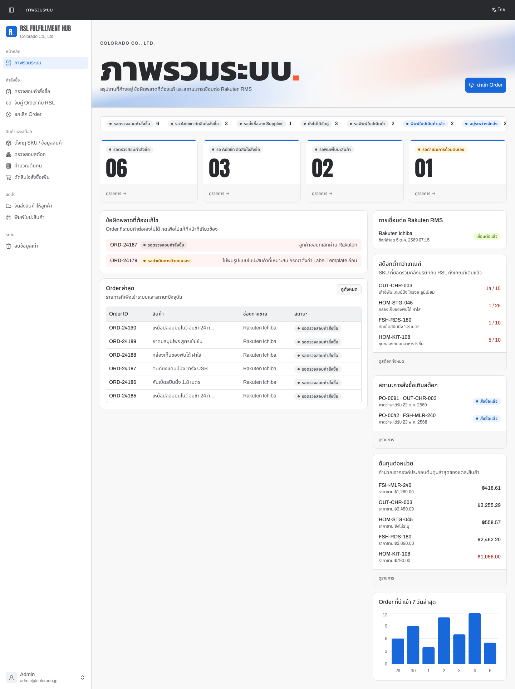 |
| OrderVerifyScreen | 2A ตรวจสอบคำสั่งซื้อ | 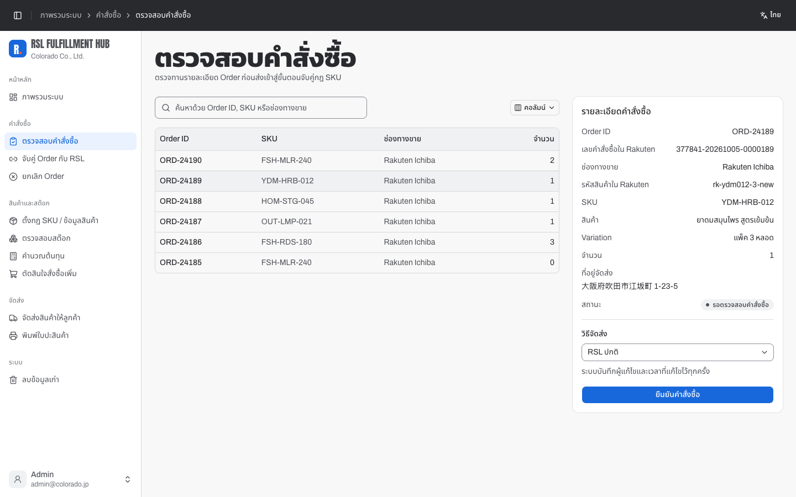 |
| RslMatchScreen | 1S จับคู่ Order กับเลข RSL | 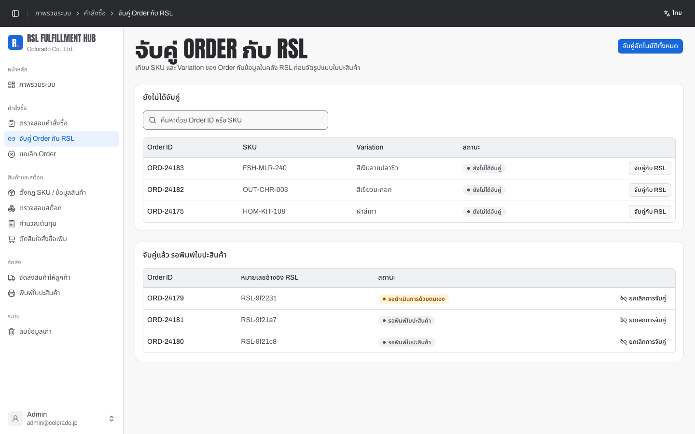 |
| ProductScreen | 3A ตั้งกฎ SKU | 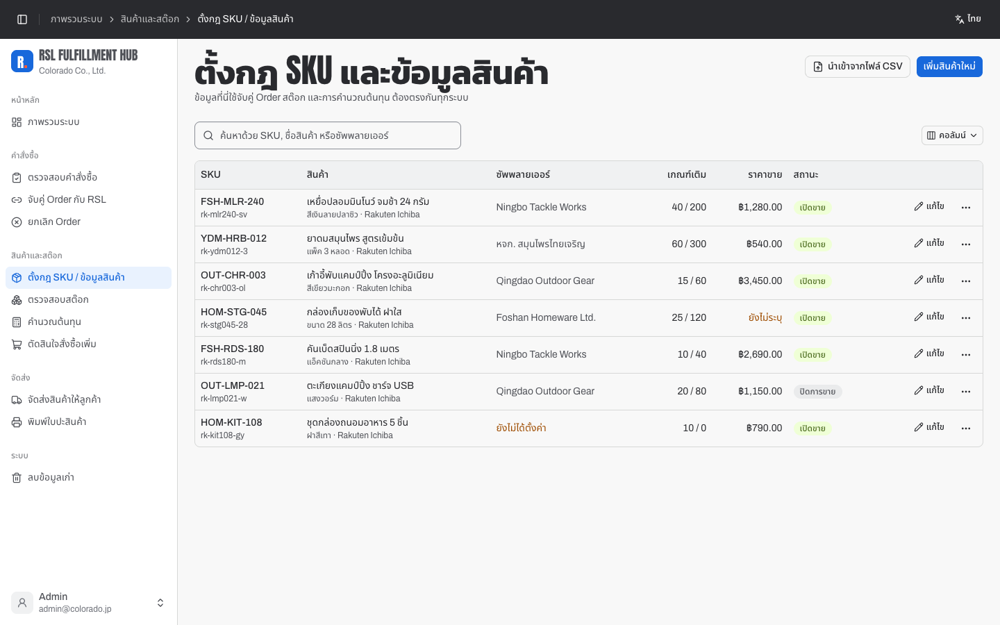 |
| StockCheckScreen | 3S ตรวจสอบของสินค้าใน stock + RSL | 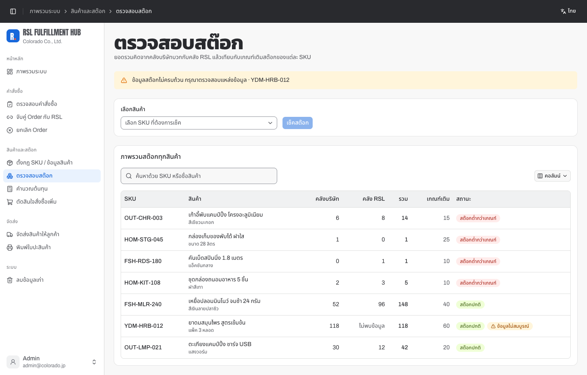 |
| CostCalculatorScreen | 4S คำนวณ Cost ในการสั่งสินค้าเติม stock เอง | 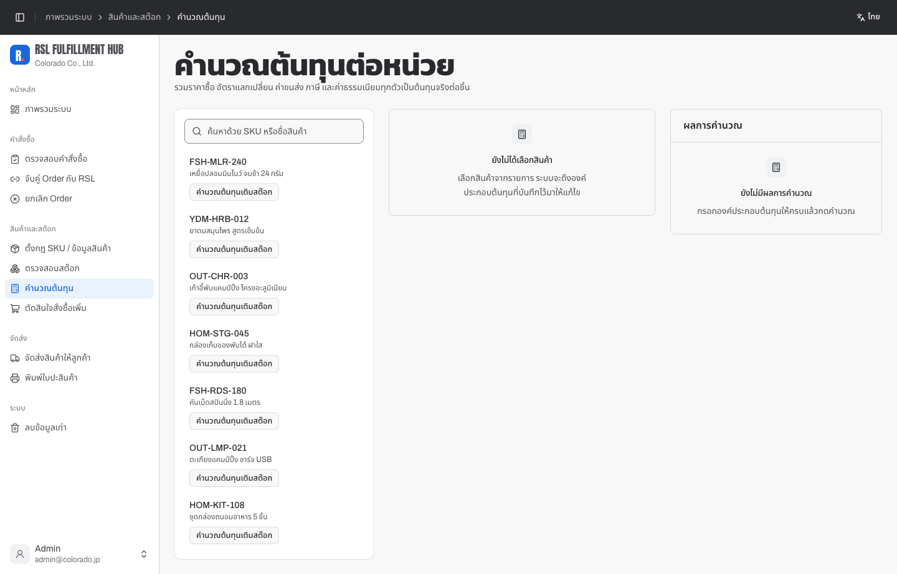 |
| ReorderDecisionScreen | 5A ตัดสินใจการสั่งซื้อสินค้าเพิ่มเข้า stock, 6A สั่งซื้อสินค้าเพิ่มเข้า stock จาก supplier | 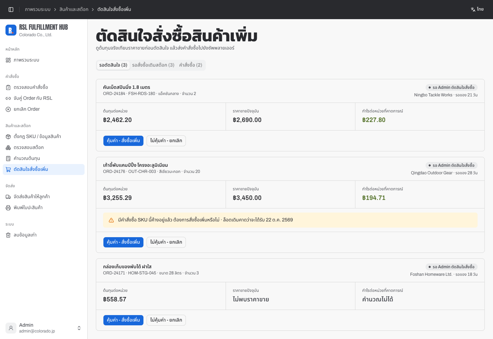 |
| CancelOrderScreen | 7A ยกเลิก Order | 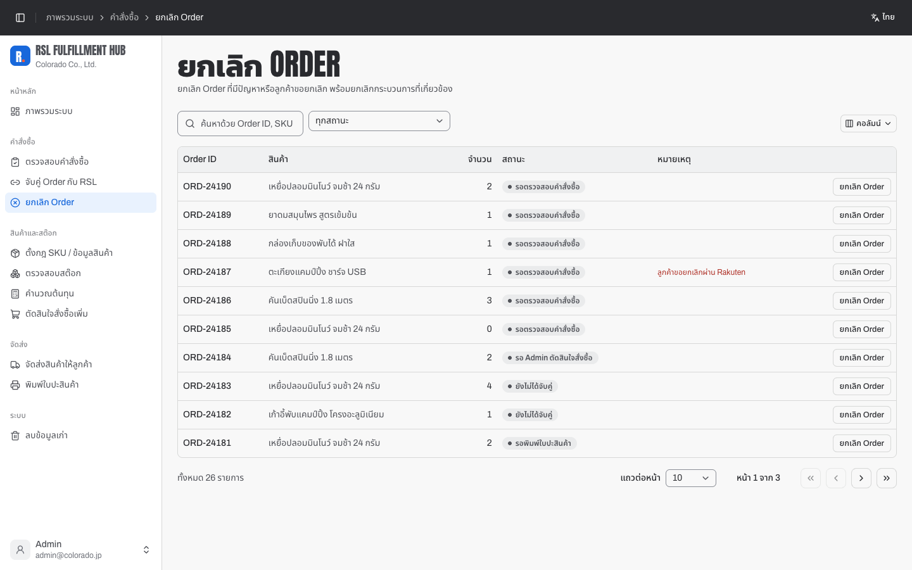 |
| ShipmentScreen | 8A จัดส่งสินค้าให้ลูกค้าผ่าน Delivery, 5S ส่งเลขติดตาม | 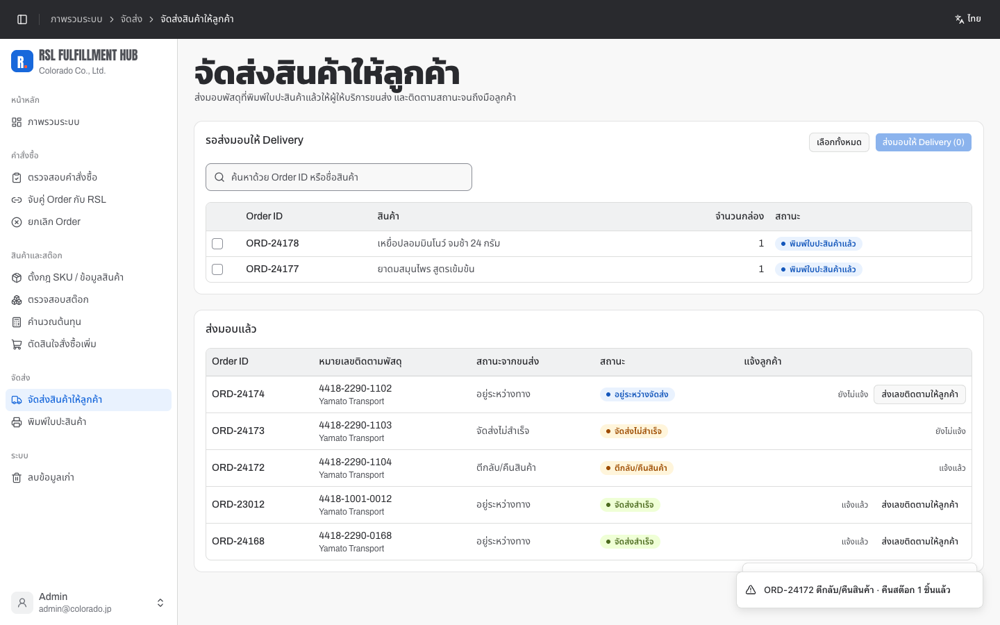 |
| LabelPrintScreen | 9A พิมพ์ใบปะสินค้า | 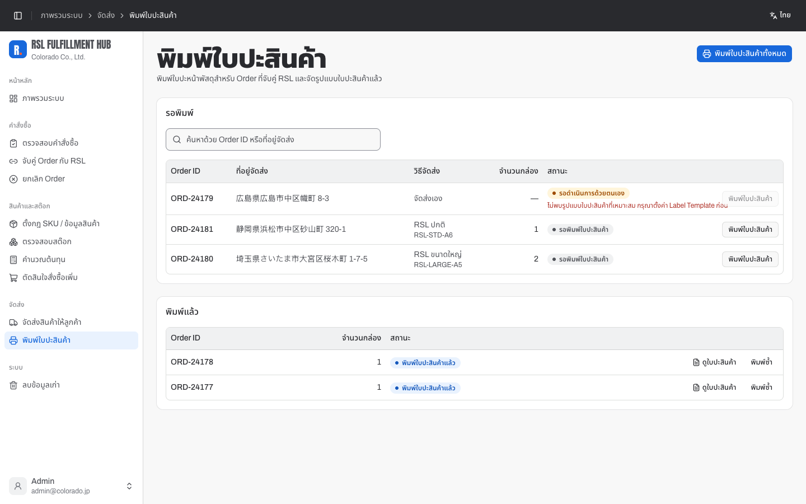 |
| DataCleanupScreen | 10A ลบข้อมูลเก่าที่ไม่ใช้แล้ว | 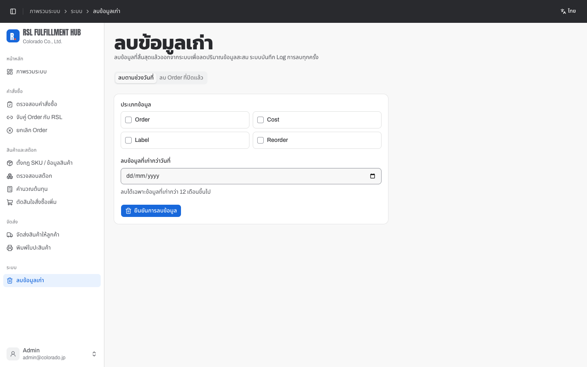 |

---

## 2.24 Output Design (Report)

ระบบมี 2 รายงาน ทั้งคู่เป็นหน้าสำหรับพิมพ์ที่เปิดจากหน้าจอเดิม ตอนพิมพ์จะซ่อนเมนูและปุ่มออก

### รายงานที่ 1 — ใบปะสินค้า (Shipping Label)

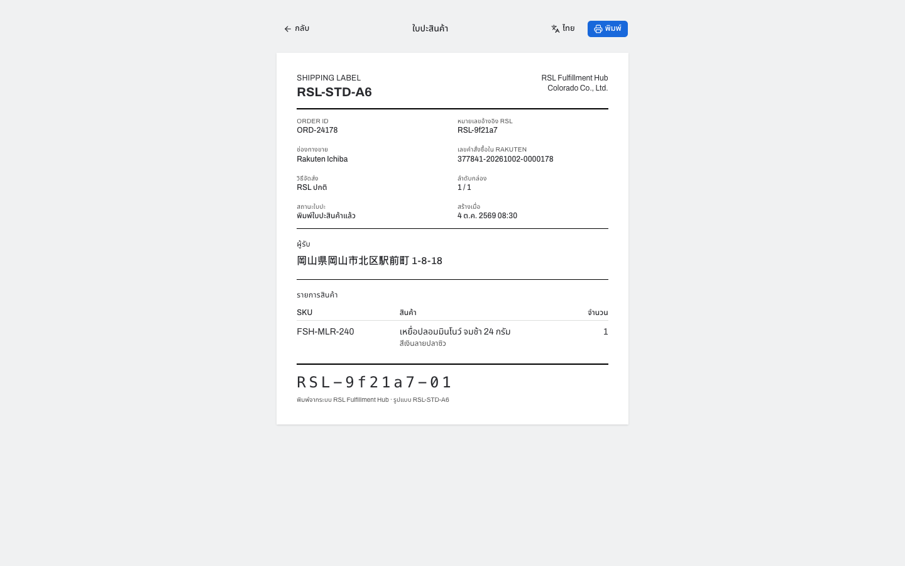

รูปแสดงใบปะสินค้าของ ORD-24178

- ที่มา: สร้างโดย UC 6S จัดรูปแบบใบปะสินค้า และพิมพ์ผ่าน UC 9A จากหน้า LabelPrintScreen
- ข้อมูลมาจาก Q6S.2 (ตาราง `label`) และตาราง `orders`

| ส่วนของรายงาน | ข้อมูล | ที่มา |
|---|---|---|
| หัวรายงาน | รูปแบบใบปะ (`label_template`) เช่น RSL-STD-A6 | Q6S.1, Q6S.2 |
| ข้อมูล Order | Order ID, เลขอ้างอิง RSL (`rsl_no`), ช่องทางขาย, เลขคำสั่งซื้อใน Rakuten, วิธีจัดส่ง | `orders`, 1S |
| ลำดับกล่อง | `parcel_seq` / `parcel_total` เช่น 1/1 หรือ 1/2 | Q6S.2 |
| สถานะ | `label_status` และวันเวลาที่สร้าง (`created_at`) | Q6S.2, 9A |
| ผู้รับ | ที่อยู่จัดส่ง | `orders.shipping_address` |
| รายการสินค้า | SKU, ชื่อสินค้า, Variation, จำนวน | `orders` |
| ท้ายใบ | เลขอ้างอิงสำหรับสแกน (เลข RSL + ลำดับกล่อง) | Q6S.2 |

### รายงานที่ 2 — รายงานต้นทุนต่อหน่วย (Unit Cost Report)

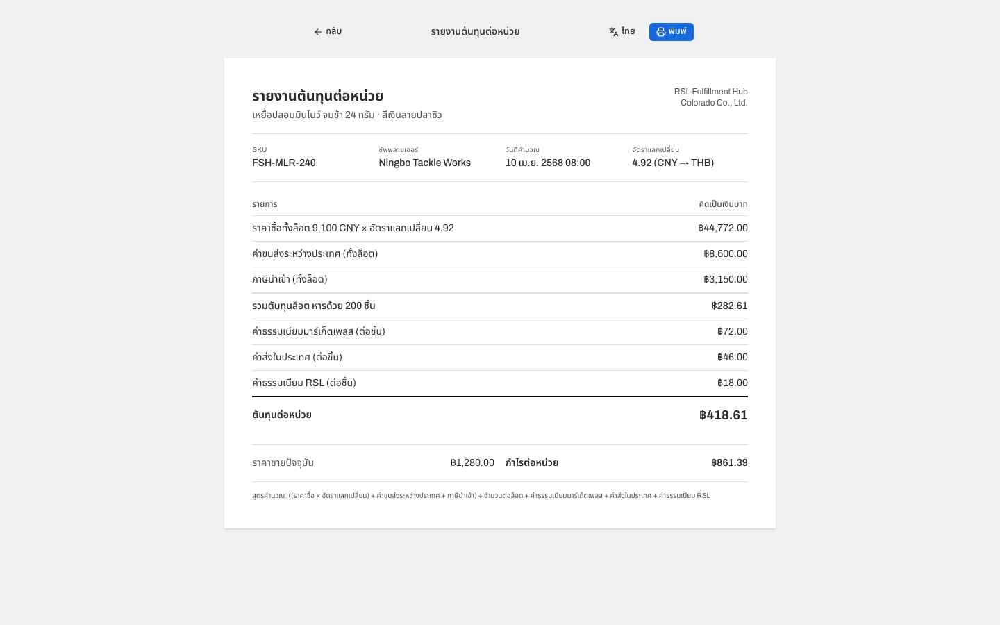

รูปแสดงรายงานต้นทุนต่อหน่วยของ FSH-MLR-240

- ที่มา: UC 4S คำนวณ Cost ในการสั่งสินค้าเติม stock เอง เปิดจากหน้า CostCalculatorScreen
- สูตรจาก Q5.2 ผลการคำนวณบันทึกด้วย Q5.3 (cost log)

```
Unit Cost = ((purchase_price × exchange_rate) + intl_freight + duty_fee) / order_qty
            + marketplace_fee + domestic_shipping + rsl_charge
```

| ส่วนของรายงาน | ข้อมูล |
|---|---|
| หัวรายงาน | SKU, ชื่อสินค้า, วันที่คำนวณ, อัตราแลกเปลี่ยนที่ใช้ |
| รายการต้นทุน | ราคาซื้อทั้งล็อต, อัตราแลกเปลี่ยน, ค่าขนส่งระหว่างประเทศ, ภาษีนำเข้า, จำนวนที่สั่ง, ค่าธรรมเนียม Marketplace, ค่าส่งในประเทศ, ค่าธรรมเนียม RSL แยกบรรทัด |
| สรุป | ต้นทุนต่อหน่วย เทียบกับราคาขาย |
| ประวัติ | ผลการคำนวณครั้งก่อนจาก cost log |

---

## 2.26 การทดสอบโปรแกรมทำงานตาม Use Case Description

ทดสอบบนเว็บจริงด้วยข้อมูลตัวอย่าง เริ่มจากข้อมูลตั้งต้นทุกครั้ง
กรณีระบบภายนอกล่ม ใช้หน้า `/dev` (ไม่อยู่ในเมนู) จำลองข้อผิดพลาดตาม "ทางเลือก" ของแต่ละ UC
บัญชีทดสอบ: `admin@colorado.jp` และ `locked@colorado.jp` (บัญชีที่ถูกล็อก)

ข้อความที่คาดหวังคัดมาจาก Use Case Description คำต่อคำ ทุกกรณีผ่าน

| UC | ชื่อ UC | กรณีทดสอบ | ผลที่คาดหวัง (ข้อความจาก UC) | ผล | รูป |
|---|---|---|---|---|---|
| 1A | เข้าสู่ระบบ | กรอก `admin@colorado.jp` ถูกต้อง | "เข้าสู่ระบบสำเร็จ" แล้วไปหน้า Dashboard | ผ่าน | 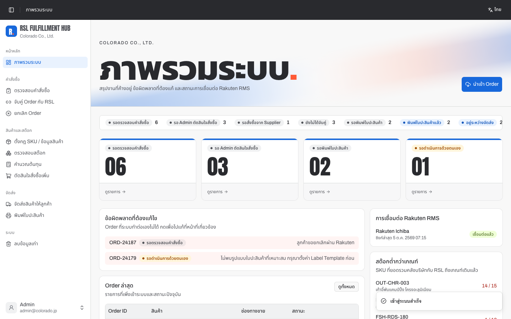 |
| 1A | เข้าสู่ระบบ | ใช้บัญชีที่เข้าผิดบ่อยเกินไป | "คุณพยายามเข้าสู่ระบบบ่อยเกินไป กรุณารอสักครู่ก่อนลองใหม่อีกครั้ง" | ผ่าน | 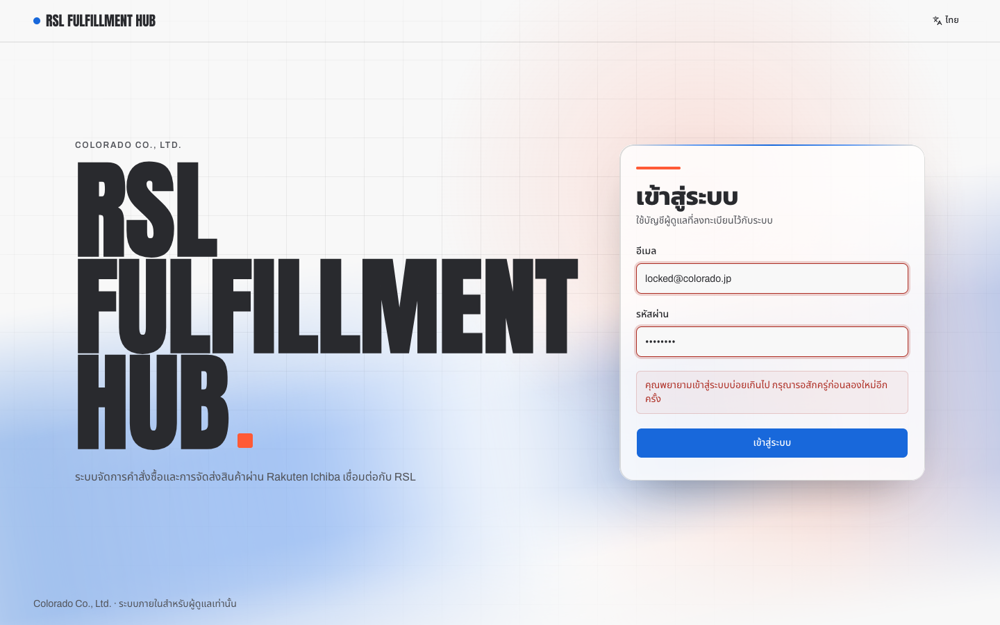 |
| 4A | ดึง Order เข้าระบบ | กดนำเข้า Order | "นำเข้า Order สำเร็จ 2 รายการ" และแจ้ง Order ซ้ำ / ไม่ครบ / SKU ที่ยังไม่ลงทะเบียน / ลูกค้าขอยกเลิก | ผ่าน | 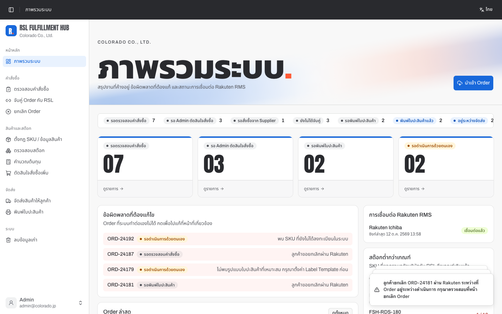 |
| 4A | ดึง Order เข้าระบบ | Rakuten RMS เชื่อมต่อไม่ได้ | "ไม่สามารถเชื่อมต่อกับ Rakuten Ichiba ได้ กรุณาตรวจสอบการตั้งค่า" | ผ่าน | 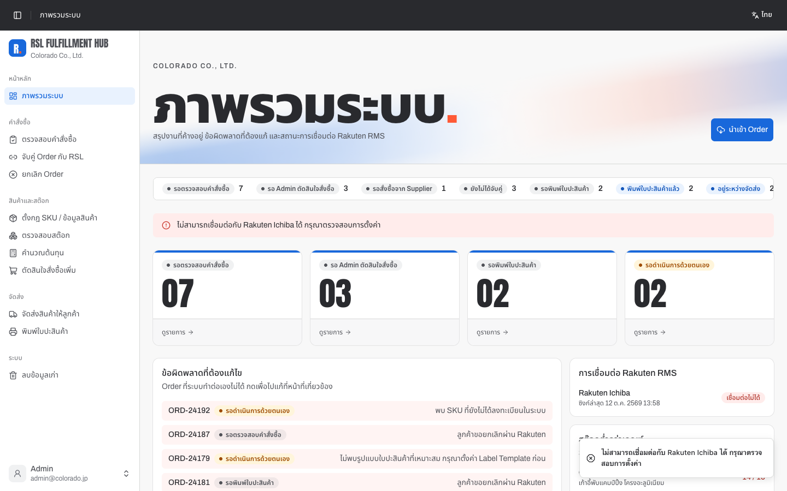 |
| 2A | ตรวจสอบคำสั่งซื้อ | ยืนยัน ORD-24190 | "ยืนยันคำสั่งซื้อสำเร็จ" | ผ่าน | 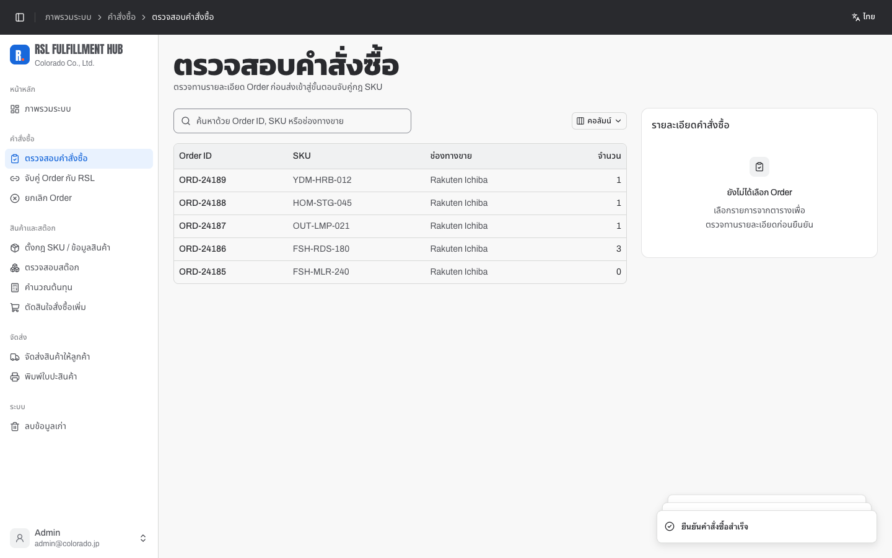 |
| 2A | ตรวจสอบคำสั่งซื้อ | Marketplace ตอบกลับไม่ได้ | "ไม่สามารถตรวจสอบข้อมูลล่าสุดจาก Marketplace ได้ กรุณาลองใหม่ภายหลัง" | ผ่าน | 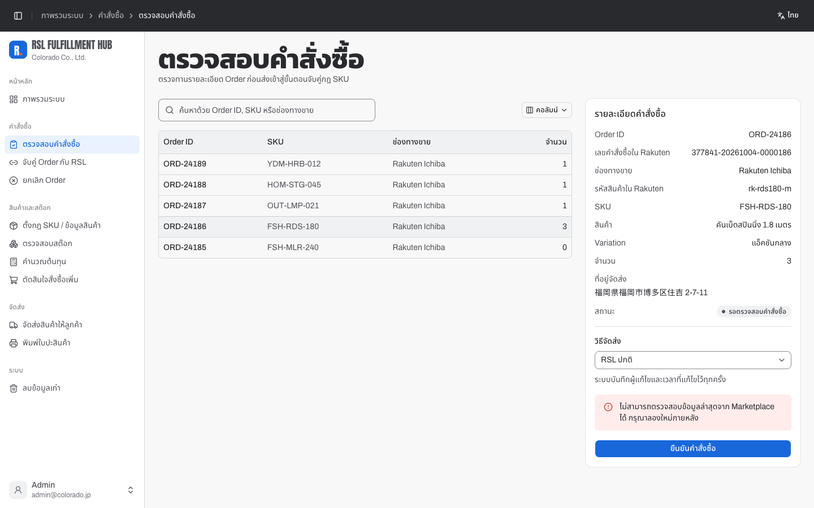 |
| 2S | จับคู่กฎ SKU | ต่อจาก 2A (ระบบทำเอง) | "จับคู่กฎ SKU สำเร็จ 1 รายการ" | ผ่าน |  |
| 2S | จับคู่กฎ SKU | อ่านข้อมูลกฎ SKU ไม่ได้ | "ไม่สามารถอ่านข้อมูลกฎ SKU ได้ กรุณาลองใหม่ภายหลัง" | ผ่าน | 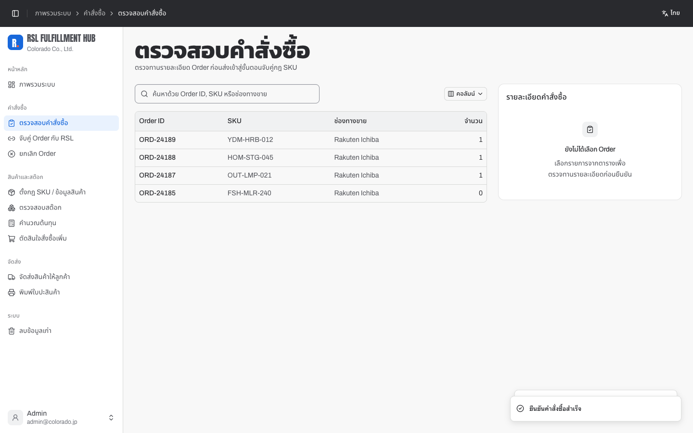 |
| 3S | ตรวจสอบของสินค้าใน stock + RSL | ต่อจาก 2S (ระบบทำเอง) | "ORD-24190 สต๊อกเพียงพอ ส่งต่อไปจับคู่กับ RSL" | ผ่าน |  |
| 3S | ตรวจสอบของสินค้าใน stock + RSL | RSL เชื่อมต่อไม่ได้ | "ไม่สามารถดึงข้อมูลสต๊อกจาก RSL ได้ กรุณาลองใหม่ภายหลัง" แสดงเฉพาะสต๊อกในคลังบริษัท | ผ่าน | 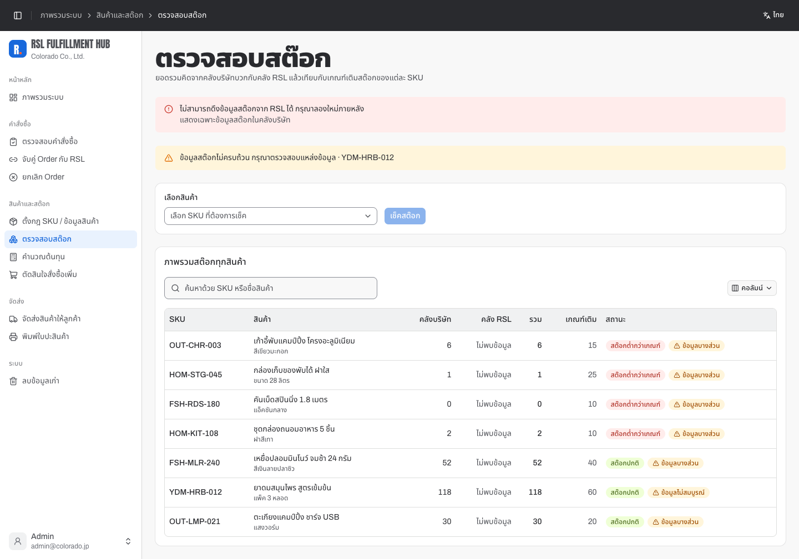 |
| 1S | จับคู่ Order กับเลข RSL | จับคู่ ORD-24183 | "จับคู่ Order กับ RSL สำเร็จ" พร้อมเลข RSL | ผ่าน | 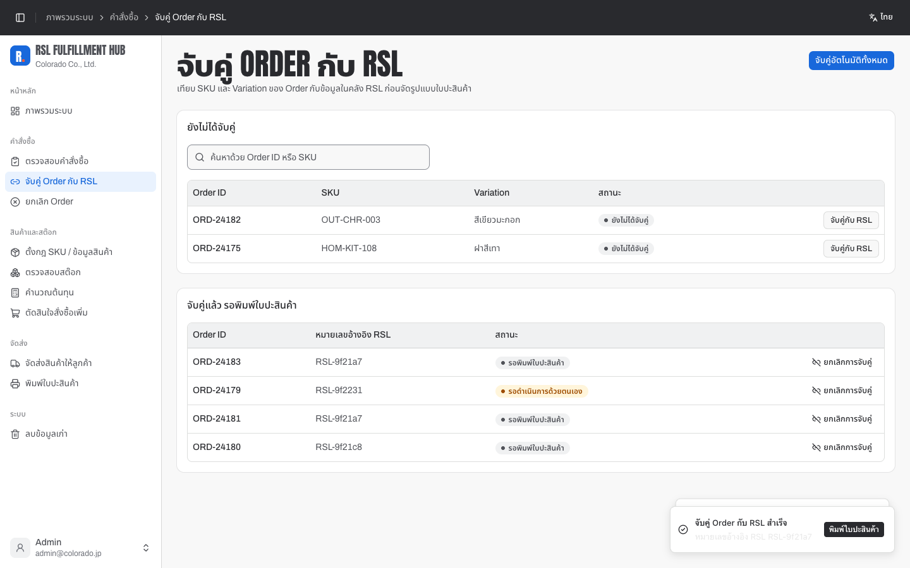 |
| 1S | จับคู่ Order กับเลข RSL | RSL เชื่อมต่อไม่ได้ | "ไม่สามารถเชื่อมต่อกับระบบ RSL ได้ กรุณาลองใหม่ภายหลัง" | ผ่าน | 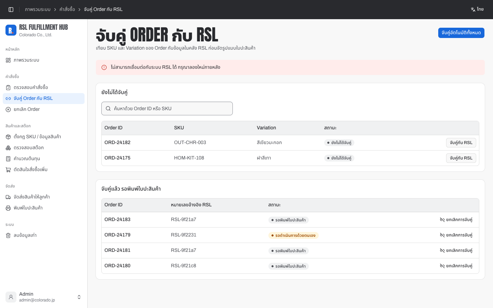 |
| 6S | จัดรูปแบบใบปะสินค้า | ต่อจาก 1S (ระบบทำเอง) | "สร้างใบปะสินค้าสำเร็จ 1 ใบ" | ผ่าน |  |
| 6S | จัดรูปแบบใบปะสินค้า | บริการสร้าง Label ล่ม | "ไม่สามารถสร้างใบปะสินค้าได้ กรุณาลองใหม่ภายหลัง" | ผ่าน | 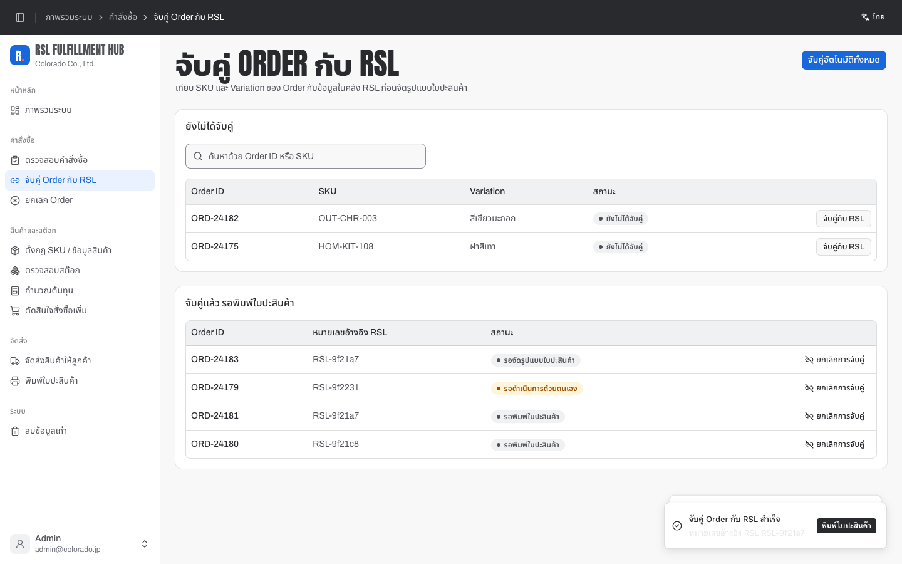 |
| 3A | ตั้งกฎ SKU | แก้ไขสินค้าแล้วบันทึก | "บันทึกข้อมูลสินค้าสำเร็จ" | ผ่าน | 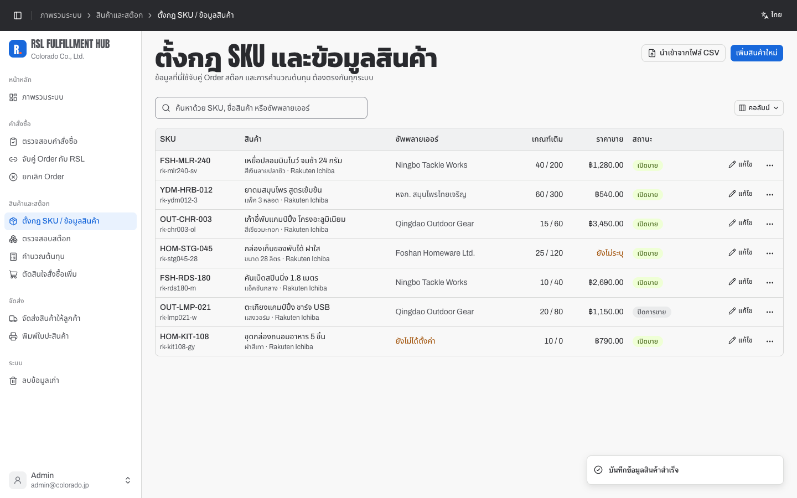 |
| 3A | ตั้งกฎ SKU | เพิ่มสินค้าโดยไม่กรอกข้อมูล | "กรุณากรอกข้อมูลให้ครบถ้วน" | ผ่าน | 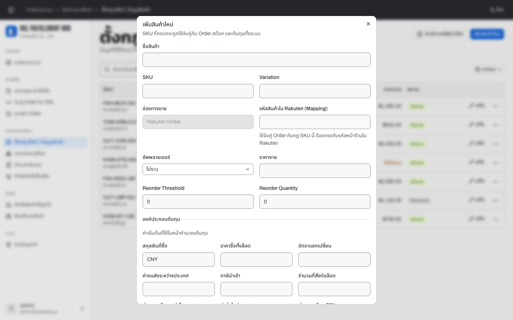 |
| 4S | คำนวณ Cost ในการสั่งสินค้าเติม stock เอง | คำนวณด้วยข้อมูลครบ | "คำนวณต้นทุนต่อหน่วยแล้ว" | ผ่าน | 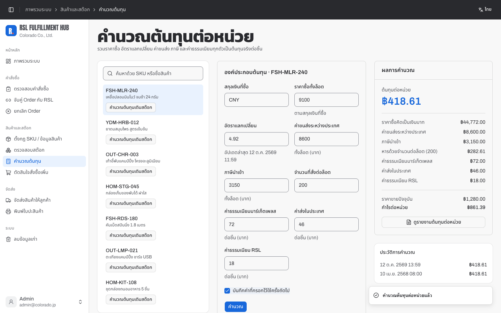 |
| 4S | คำนวณ Cost ในการสั่งสินค้าเติม stock เอง | ลบราคาซื้อออกแล้วคำนวณ | "กรุณากรอกข้อมูลต้นทุนให้ครบถ้วนและถูกต้อง" | ผ่าน | 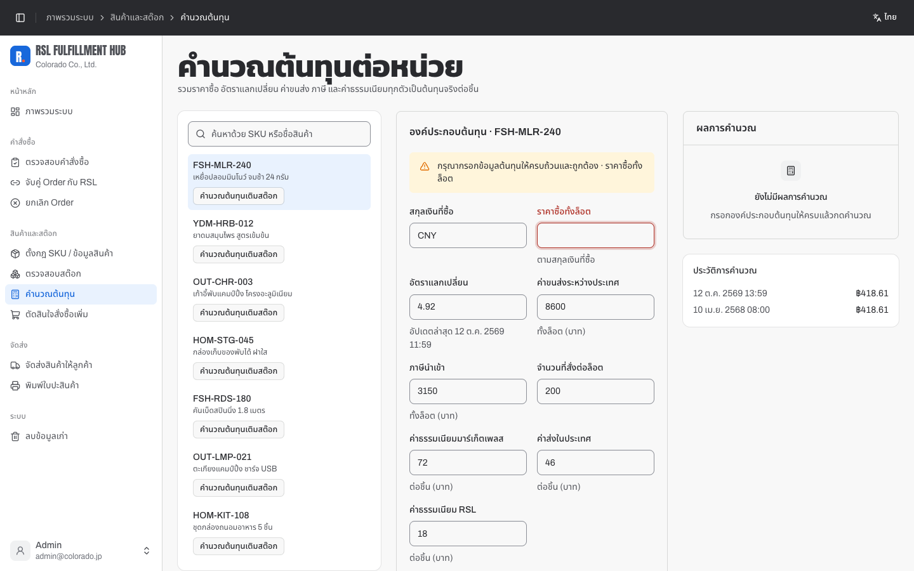 |
| 5A | ตัดสินใจการสั่งซื้อสินค้าเพิ่มเข้า stock | เลือก "คุ้มค่า" ของ ORD-24184 | "บันทึกผลการตัดสินใจสำเร็จ" | ผ่าน | 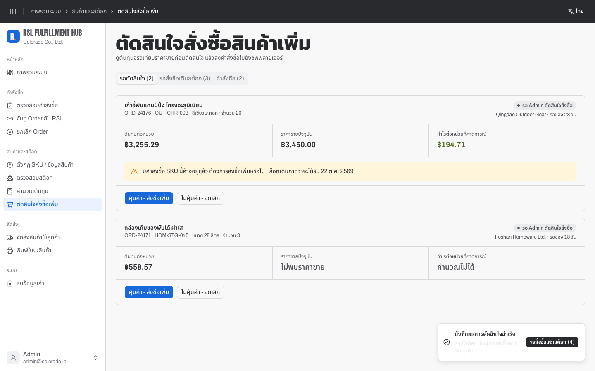 |
| 5A | ตัดสินใจการสั่งซื้อสินค้าเพิ่มเข้า stock | ฐานข้อมูลบันทึกไม่ได้ | "ไม่สามารถบันทึกผลการตัดสินใจได้ กรุณาลองใหม่ภายหลัง" | ผ่าน | 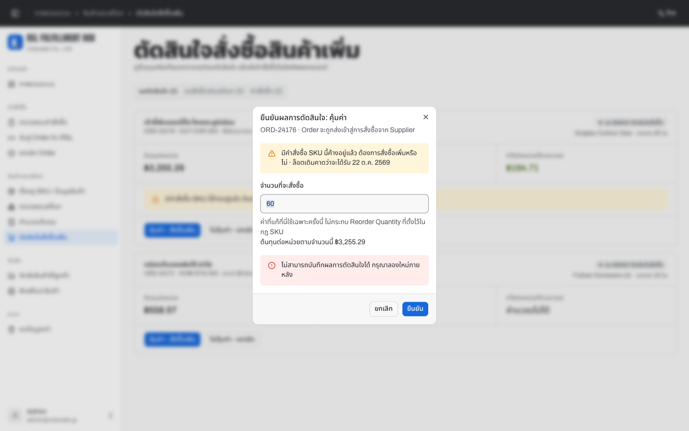 |
| 6A | สั่งซื้อสินค้าเพิ่มเข้า stock จาก supplier | สั่งซื้อ FSH-RDS-180 | สถานะเป็น "สั่งซื้อแล้ว" พร้อมวันที่คาดว่าจะได้รับสินค้า | ผ่าน | 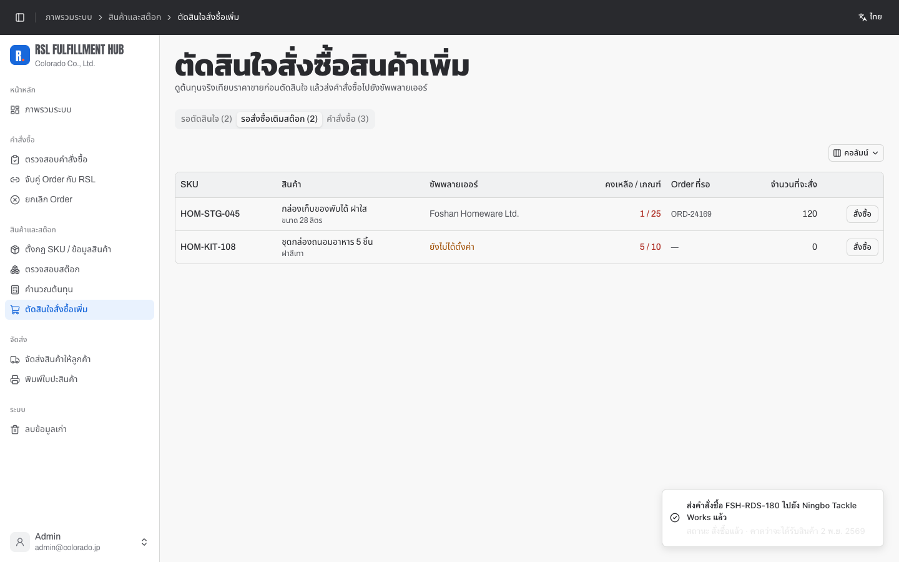 |
| 6A | สั่งซื้อสินค้าเพิ่มเข้า stock จาก supplier | ส่งคำสั่งซื้อไปยัง Supplier ไม่ได้ | "ส่งคำสั่งซื้อไม่สำเร็จ กรุณาตรวจสอบและลองใหม่" คงสถานะ "รอส่งคำสั่งซื้อ" | ผ่าน | 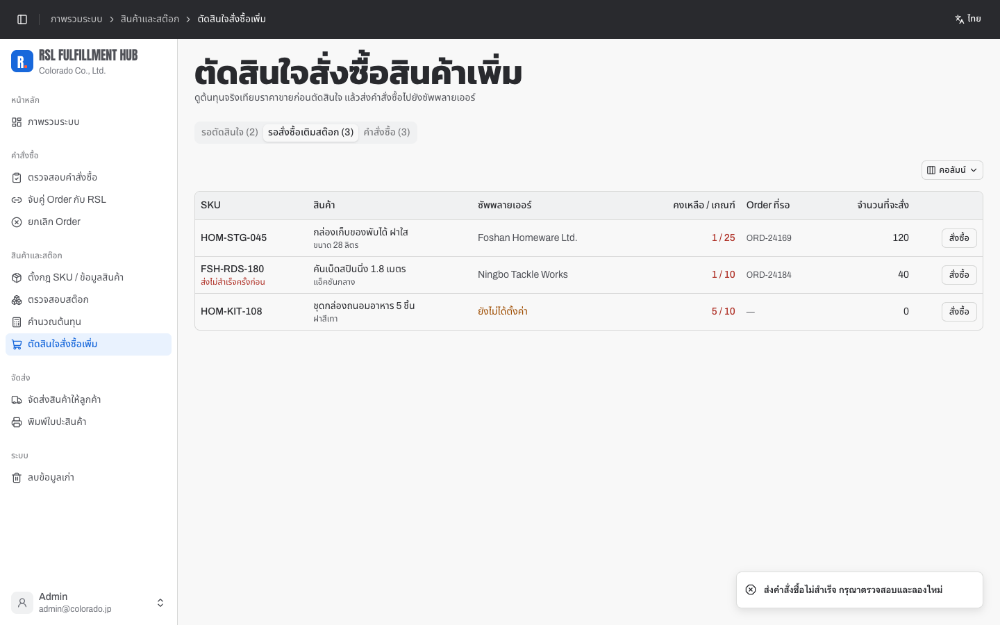 |
| 7A | ยกเลิก Order | ใส่เหตุผลแล้วยืนยัน | "ยกเลิก Order สำเร็จ" | ผ่าน | 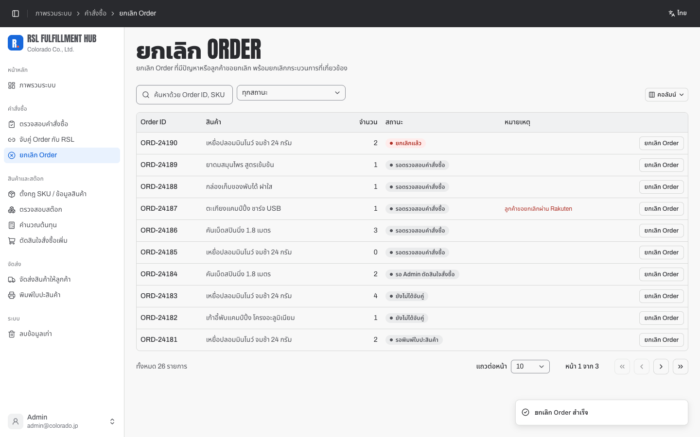 |
| 7A | ยกเลิก Order | ไม่ใส่เหตุผล | "กรุณาระบุเหตุผลการยกเลิก" | ผ่าน | 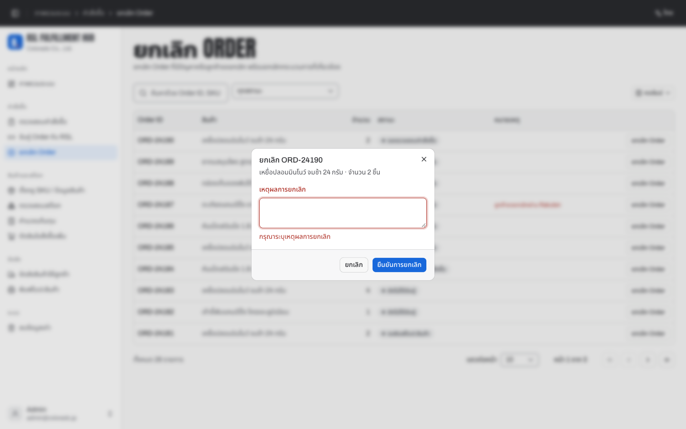 |
| 9A | พิมพ์ใบปะสินค้า | พิมพ์ ORD-24181 | ส่งใบปะไปยังเครื่องพิมพ์ สถานะเป็น "พิมพ์ใบปะสินค้าแล้ว" | ผ่าน | 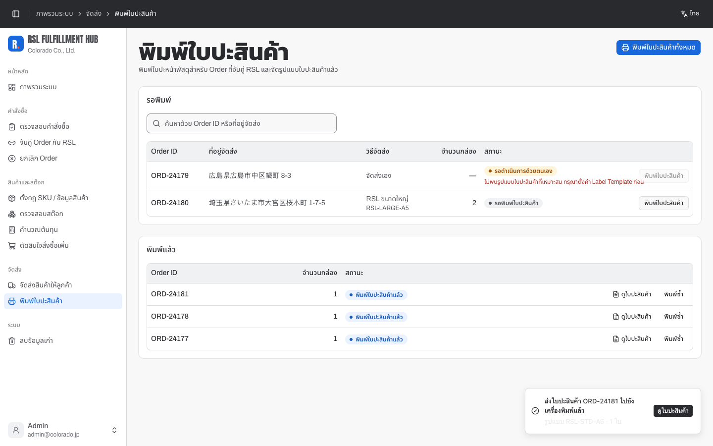 |
| 9A | พิมพ์ใบปะสินค้า | เครื่องพิมพ์ไม่พร้อม | "พิมพ์ใบปะสินค้าไม่สำเร็จ กรุณาตรวจสอบเครื่องพิมพ์" | ผ่าน | 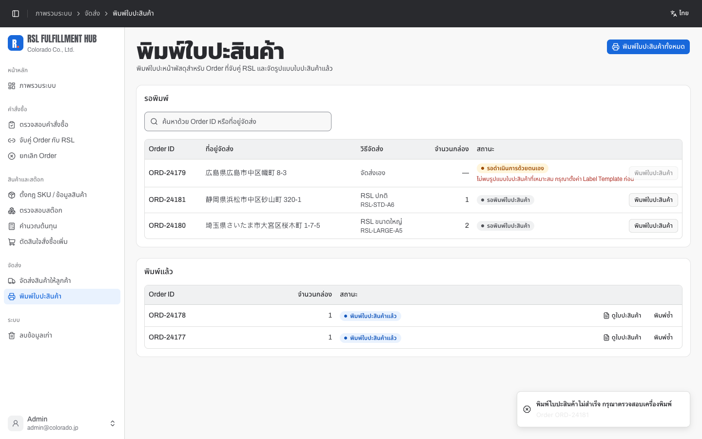 |
| 8A | จัดส่งสินค้าให้ลูกค้าผ่าน Delivery | ส่งมอบ ORD-24178 | ได้หมายเลขติดตามพัสดุ สถานะเป็น "อยู่ระหว่างจัดส่ง" | ผ่าน | 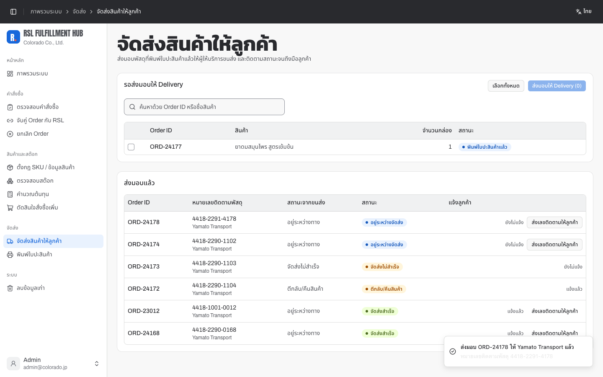 |
| 8A | จัดส่งสินค้าให้ลูกค้าผ่าน Delivery | ดึงสถานะจากขนส่งไม่ได้ | "ไม่สามารถดึงสถานะจากผู้ให้บริการขนส่งได้ กรุณาลองใหม่ภายหลัง" | ผ่าน | 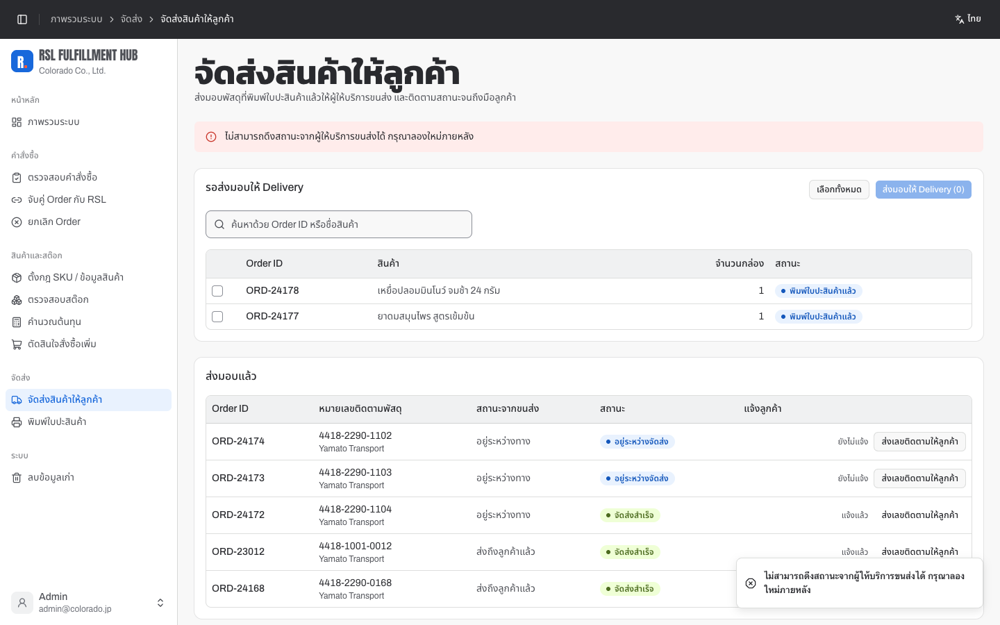 |
| 5S | ส่งเลขติดตามสินค้าของ Delivery ให้ลูกค้าผ่าน Marketplace | ส่งเลขติดตามของ ORD-24174 | "แจ้งเลขติดตามให้ลูกค้าสำเร็จ" | ผ่าน |  |
| 5S | ส่งเลขติดตามสินค้าของ Delivery ให้ลูกค้าผ่าน Marketplace | Rakuten รับเลขติดตามไม่ได้ | "ส่งเลขติดตามไม่สำเร็จ กรุณาลองใหม่ภายหลัง" | ผ่าน | 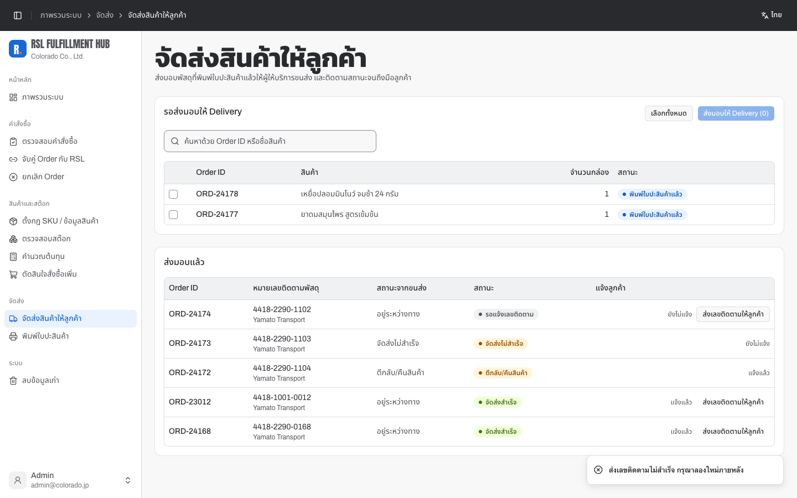 |
| 7S | ตัดสต๊อกสินค้า | ต่อจาก 5S (ระบบทำเอง) | "ตัดสต๊อกและอัปเดตจำนวนสินค้าสำเร็จ" | ผ่าน |  |
| 7S | ตัดสต๊อกสินค้า | อัปเดตจำนวนใน Rakuten ไม่ได้ | "ไม่สามารถอัปเดตจำนวนสินค้าใน Rakuten Ichiba ได้ กรุณาลองใหม่ภายหลัง" ตัดสต๊อกในระบบไว้ก่อน | ผ่าน | 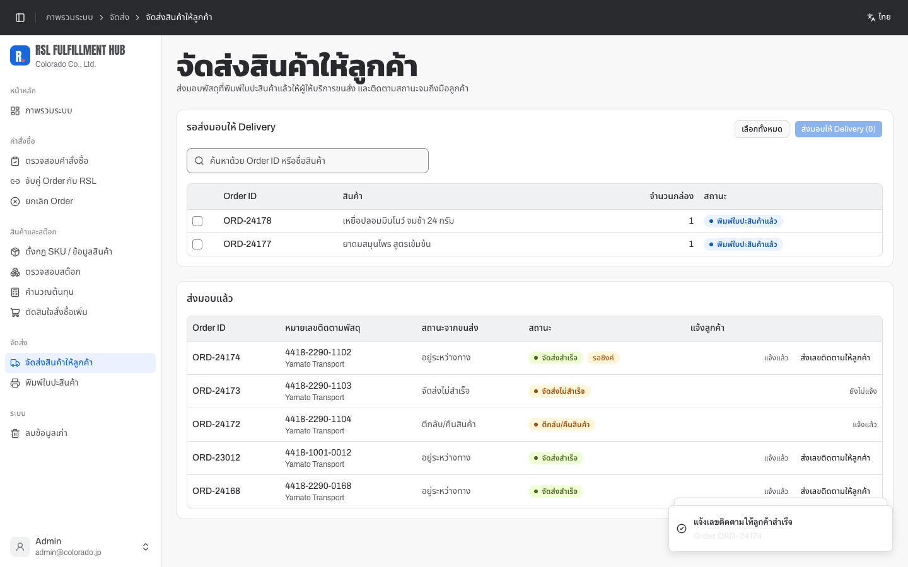 |
| 10A | ลบข้อมูลเก่าที่ไม่ใช้แล้ว | ลบ Order ที่ปิดแล้ว | "ลบ Order ที่ปิดแล้วสำเร็จ 5 รายการ" | ผ่าน |  |
| 10A | ลบข้อมูลเก่าที่ไม่ใช้แล้ว | ฐานข้อมูลขัดข้องระหว่างลบ | "ลบข้อมูลไม่สำเร็จ กรุณาลองใหม่ภายหลัง" | ผ่าน | 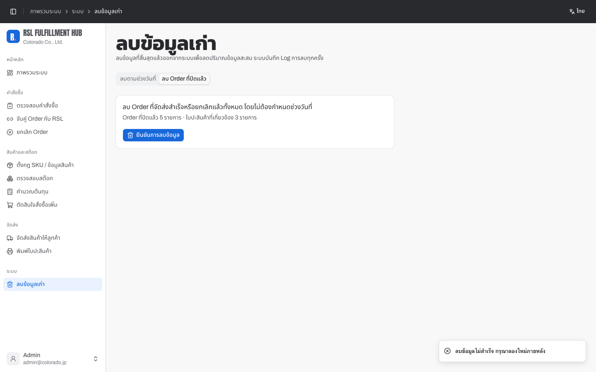 |
